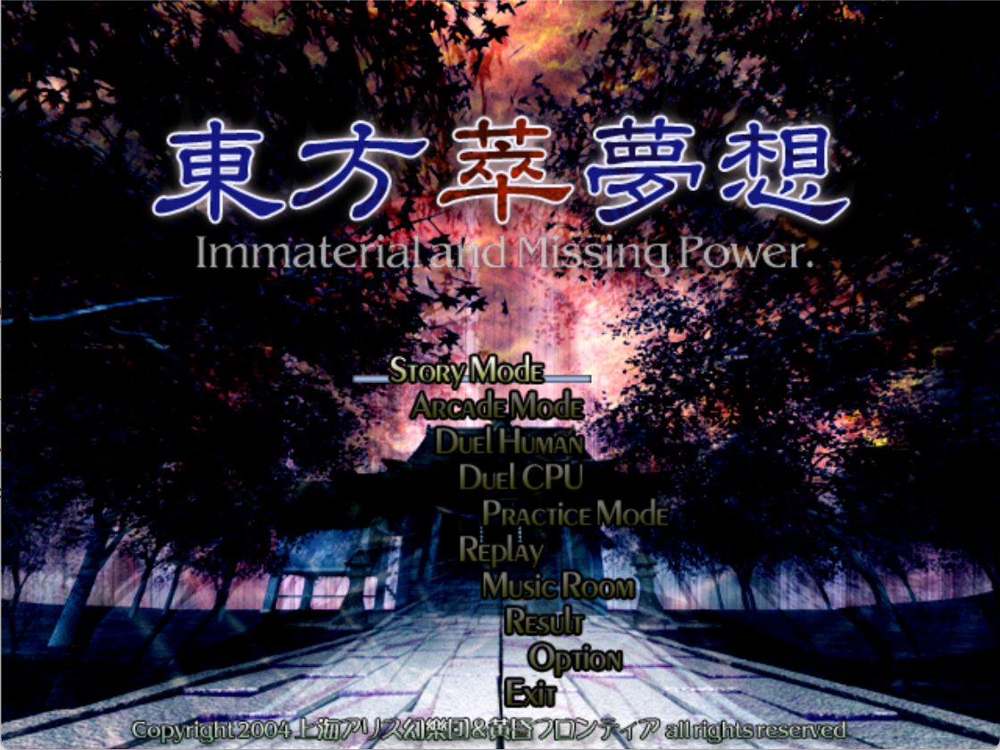
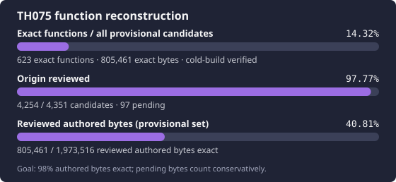

# 東方萃夢想 ～ Immaterial and Missing Power

<p align="center"></p>
<p align="center"></p>

This repository reconstructs **TH075 (ver1.11) functions in natural C++**, comparing
complete VC7.1-compiled x86 code and all physical COFF relocations against a
user-supplied executable. It is **not yet a complete game rebuild**.

## Pinned target and progress

| Property | Value |
| --- | --- |
| Target | Japanese `th075.exe` (ver1.11), supplied by the user |
| Size / image base | 2,576,384 bytes / `0x00400000` |
| SHA-256 | `bd441e99075436e8dcad26f86ffcf5e6aac4f58b0ed3ee7442e4cb39d8e22c98` |
| MD5 | `21bcb855a39f2170195811e6ad292f18` |
| Source-present / exact functions | **576 / 576** |
| Accepted CODE bytes | **788,826** |
| Reviewed authored coverage | **39.97%** of 1,973,516 reviewed bytes |
| Conservative coverage | **39.90%**, with 3,608 origin-pending bytes included |
| Unresolved origins | **97** of 4,351 provisional function candidates |

**The 98% authored-byte goal is incomplete.** Function labels and C++ owner
types are provisional; machine-code matches alone do not prove an entire
original class layout. The target's official distribution provenance has not
been independently verified; do not substitute a localized `th075c.exe`.

These counts are a snapshot after the **F256-F262** cold-exact adoptions
(2026-10-28). Always get live counts from
`scripts/repo-python scripts/report-reconstruction-status.py --summary`.
Local Git commits preserve checkpoints; they are **not external Oracle
verification receipts**.

## Begin a new reconstruction session

**Read [the current agent handoff](docs/RE_HANDOFF.md) first.** It lists current
unresolved large functions, the latest accepted units, private research to
retain and the next experiments. Then follow
[AGENTS.md](AGENTS.md), [the reconstruction workflow](docs/RE_WORKFLOW.md)
and the [source-backed knowledge base](docs/KNOWLEDGE_BASE.md).

Inspect **all dirty work** before editing; do not discard it because an
earlier agent left it. Address both large/core functions and small helpers,
recheck old hypotheses against native instructions, and promptly commit
substantial accepted progress using `gpt-web: ...` subjects.
Preserve and continue all pre-existing dirty work; the user reports no other active reconstruction session.

From the repository root:

```bash
git status --short --branch
scripts/repo-python scripts/verify-target.py
scripts/repo-python scripts/validate-tracking.py --require-target
scripts/repo-python scripts/report-reconstruction-status.py --summary
scripts/repo-python scripts/ghidra.py check
```

Use the hash-checked `scripts/repo-python` wrapper, not arbitrary system
Python. For a new installation see `scripts/bootstrap-python.sh` and
`scripts/bootstrap-tools.sh`; **do not re-import or overwrite the
already initialized target/Ghidra project**.

## Complete-function matching

Full source and all relocations for each accepted function are registered
in `config/match-units.toml`. Reconstruct the genuine function, including
all exits and owned jump tables. `structural-exact` excludes relocation
fields and is **only diagnostic**. Acceptance requires an independent
pinned-compiler cold replay:

```bash
scripts/repo-python scripts/replay-exact-units.py --unit UNIT_NAME
scripts/repo-python scripts/validate-tracking.py --require-target
git diff --check
```

For probes, use VC7.1 build 3077 with explicit per-unit flags, serialized
headless Wine processes and the existing tools. Do not manufacture byte
matches with copied target bytes, assembly, arbitrary padding, masks or
unproved owner layouts. Do not count external data or runtime helper bytes.
Keep the 97 unresolved origin candidates uncredited.

Keep validation focused on exact reconstruction: `scripts/ci.py` runs the small
comparison/checkpoint/byte-accounting suite without compiling accepted units.
Run it when that infrastructure or its tests change. Cold-replay only new or
affected units; routine acceptance and handoff need no additional suite.
Do not add a test file per function, duplicate source-text assertions, or
allocation-failure/null-pointer tests. Do not run the full historical suite.
Historical origin tests remain available for changes to
their evidence or verifiers. See [the workflow](docs/RE_WORKFLOW.md).

## Finding information

| Resource | Purpose |
| --- | --- |
| [Current handoff](docs/RE_HANDOFF.md) | Live status and next practical tasks |
| [Reconstruction workflow](docs/RE_WORKFLOW.md) | Step-by-step native analysis, VC7.1 matching, acceptance |
| [Knowledge base](docs/KNOWLEDGE_BASE.md) | Detailed F-series proofs, rejected attempts and limitations |
| [Build and matching guide](docs/BUILD_MATCHING.md) | Compiler profiles, COFF and cold-replay mechanics |
| [Ghidra MCP guide](docs/GHIDRA_MCP.md) | Headless project/bridge operation |
| [Origin review](docs/ORIGIN_PENDING_REVIEW.md) | 97 unclassified origins |
| [Historical handoffs](docs/history/RE_HANDOFF_THROUGH_F183.md) | Superseded records; not the current task list |

The pre-cleanup verbose F223 handoff and README are also recoverable from
Git commit `ca81d72`; older origin work is retained under `docs/history/`,
`docs/RE_HANDOFF_HISTORY.md` and `docs/ORIGIN_REVIEW.md`. Private native
analysis, experiments and build objects are ignored by Git and must remain in
the **same workspace** when changing agents. Protect the `.analysis/vc71-wine`
tool environment, shared `.tools` installations and `ghidra-project`.

## Copyright and license

Repository code and documentation use the [MIT license](LICENSE).
The game, its data and supplied artwork retain their original rights. No
game executable, protected analysis database, downloaded toolchain or private
MCP endpoint is distributed with this repository.
