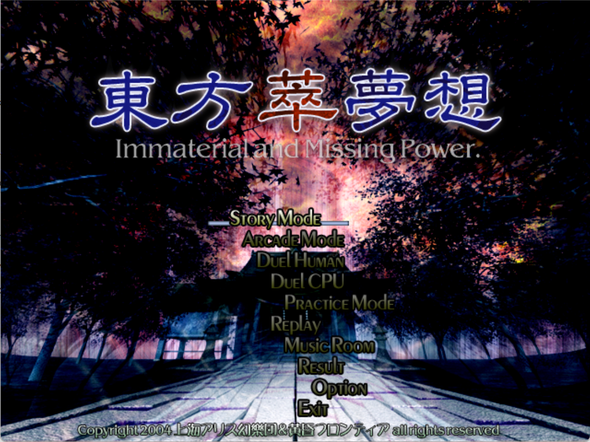

# 東方萃夢想 ～ Immaterial and Missing Power

> [!NOTE]
> `main` builds a Windows x86 executable. [Build and play on Windows](#play-on-windows)
> using files from your own Japanese TH075 v1.11 full-version installation.
> The footage below uses the standard reconstruction build with normal damage.

Agent workflow: follow the highest-priority requirements in [AGENTS.md](AGENTS.md).

A function-by-function C++ reconstruction of the Japanese TH075 v1.11
executable, rebuilt with the original VC7.1 compiler. A function counts only
when its complete comparison extent, including all relocations, cold-builds
byte-identical to the original.

<p align="center">
  <a href="https://www.youtube.com/watch?v=MZ1ScP9qJ0I">
    
  </a>
</p>

[▶ Watch on YouTube](https://youtu.be/MZ1ScP9qJ0I) · Patchouli Knowledge · Story Mode stages 1–3 · Music Room

<p align="center"></p>
<p align="center"></p>

## Play on Windows

### 1. Prepare the Japanese v1.11 game

Install the Japanese full version and apply the publisher's v1.11 update
if needed. The commands below use `C:\Games\TH075-original` as the
example path. Keep the original installation available for verification.
[Official v1.11 update](https://tasofro.net/arc/index.html#tf012-p)

| File | Used for |
| --- | --- |
| `th075.exe` | Original Japanese v1.11 executable. The build reads link data from this image and checks its SHA-256. |
| `th075.dat` | Game resources for the playable build. |
| `th075bgm.dat` | Music for the playable build. |
| `th075b.dat` | Additional resources for the playable build. |

### 2. Set up the build environment

Build in an x86-64 Ubuntu 24.04 WSL 2 terminal and run the result directly
on Windows. Keep the clone in the WSL filesystem, for example under
`~/src`. If WSL is new to your machine, install Ubuntu 24.04 from an
administrator PowerShell and restart if prompted.
[Microsoft WSL setup](https://learn.microsoft.com/en-us/windows/wsl/install)

```powershell
wsl --install -d Ubuntu-24.04
```

In Ubuntu, install Python 3.12 and Wine with 32-bit support, then clone
the reconstruction and initialize its Python environment.

```bash
sudo dpkg --add-architecture i386
sudo apt update
sudo apt install git python3.12-venv wine wine32:i386

mkdir -p ~/src
cd ~/src
git clone https://github.com/N0zoM1z0/th075.git
cd th075
scripts/bootstrap-python.sh
```

Provide VC7.1 build 3077 and the matching Win32/DirectX SDK files using
the revision in the tool lock. If you already have this toolchain, set
`TH075_MSVC71_ROOT` to the directory containing `Vc7/`.
[Tool lock](config/tools.lock.toml)

```bash
git clone https://github.com/archaic-msvc/msvc710.git .tools/msvc710
git -C .tools/msvc710 checkout --detach 2932d76fe417b0bc49010b26d4be2e5b743cc4be
```

Attach the shared Wine launcher using
[the one-time Factory setup](docs/SHARED_TOOLS.md#wine-setup-for-a-standalone-build).
An existing Factory-provisioned checkout can use its configured Wine prefix.

### 3. Verify the input and build

Run these commands from the checkout in WSL. Adjust the original path to
match your installation. The import copies the selected executable only
after its bytes match the pinned Japanese target.

```bash
original='/mnt/c/Games/TH075-original'
scripts/repo-python scripts/import-target.py "$original/th075.exe"
scripts/repo-python scripts/verify-target.py
scripts/repo-python scripts/build.py --program
```

The build writes `build/program/th075.exe`, `th075.map` and the compiler
and linker logs under `build/program/`. It uses the per-source profiles
and compiles serially with Wine graphics disabled. To build only the
COFF library, use `scripts/repo-python scripts/build.py --library`.
[Compiler and comparison setup](docs/BUILD_MATCHING.md)

### 4. Stage the executable and start the game

From the same WSL terminal, copy the three game data files and the
rebuilt executable into a separate writable Windows folder. Keep
`config.ini`, `score.dat` and `replay/` when updating an existing game
folder. Story Mode needs a writable `replay/` directory for its temporary
recording.

```bash
game='/mnt/c/Games/th075-reconstruct'
mkdir -p "$game/replay"
cp -- "$original"/{th075.dat,th075bgm.dat,th075b.dat} "$game/"
cp -- build/program/th075.exe "$game/th075.exe"
```

Open the folder in Windows Explorer and launch `th075.exe`, or run it
from Windows PowerShell.

```powershell
Set-Location 'C:\Games\th075-reconstruct'
.\th075.exe
```

The rebuilt game and the original completed four external recordings
with matching battle checkpoints before the semantic pass. See the
validation notes for the recorded fixture and executable scope.
[Build and replay evidence](docs/RE_HANDOFF.md#windows-x86-build) · [Position independence](docs/POSITION_INDEPENDENCE.md)

## Status

`scripts/repo-python scripts/report-reconstruction-status.py --summary`
prints the live exact coverage and origin counts. The conservative
coverage exceeds the 98% authored-byte goal. Every function currently
classified as independently authored has an accepted exact comparison,
including the fighter and object `Advance` methods and the stage base
constructor. The conservative coverage includes all pending-origin bytes.
The progress card reads the same ledgers. Regenerate it with
`scripts/repo-python scripts/update-progress.py`.

## Where to start

- [Handoff](docs/RE_HANDOFF.md) with current work and blockers
- [Advance reconstruction](docs/GIANTS.md) with the accepted source index and compiler evidence
- [Pending origin evidence](docs/ORIGIN_PENDING_REVIEW.md#r288--remaining-origin-evidence)
- [Knowledge base](docs/KNOWLEDGE_BASE.md), [workflow](docs/RE_WORKFLOW.md) and [storage policy](docs/STORAGE_HYGIENE.md)

| Subsystem | Entry point |
| --- | --- |
| [Battle](src/battle/) | [Scene phases and HUD state](src/battle/BattleScene.hpp), [shared fighter layout](src/battle/Fighter.hpp) |
| [Characters](src/characters/) | [Shared Actor](src/battle/Actor.hpp), [fighter-owned objects](src/characters/CharacterObject.hpp), [object manager](src/battle/EffectManagerLifetimeF161.hpp), auxiliary effects ([layout](src/characters/CharacterAuxAction.hpp), [state machine](src/characters/CharacterAuxAction.cpp)), [per-fighter entry points](docs/GIANTS.md) |
| [Replay](src/replay/) | [File header, record header and input streams](src/replay/ReplayRecords.hpp) |
| [Input](src/input/) | [Device mapping and held controls](src/input/InputMapping4388D0.hpp) |
| [Configuration](src/config/) | [Saved key bindings](src/config/GameConfigStorage.hpp), [display options](src/config/DisplayOptions.hpp) |
| [Engine](src/engine/) | [Scene commands](src/engine/SceneTransition.hpp), [score data](src/engine/GameProgress.hpp) |
| [Menus](src/ui/) | [Character selection](src/ui/CharacterSelectScene.hpp), [results browser](src/ui/ResultListScene.hpp) |
| [Resources](src/assets/) | [Archive index](src/assets/DataArchive.hpp), [story script records](src/assets/ScriptResource4205F0.hpp) |
| [Graphics](src/graphics/) | [Texture management](src/graphics/TextureManagerF198.hpp), [bitmap entry layout](src/graphics/TextureEntry.hpp) |
| [Audio](src/audio/) | [Streaming](src/audio/AudioStream.hpp), [sound effects](src/audio/SoundBank.hpp) |
| [Platform](src/platform/) | [Windows startup and main loop](src/platform/WinMainF1171.cpp) |

Each playable fighter has a subdirectory under `src/characters/`.
The parent directory contains shared character code.
The Windows build compiles translation units from `src/`. Character
action fragments live alongside their owners and in
[shared/actions](src/characters/shared/actions/). Cold-replay their
complete owning functions after edits. Compiler controls used by the
origin verifiers live in [tests/origin_probes](tests/origin_probes/).
Use `.analysis/` for experiments.

`config/match-units.toml` records the compiler profiles, extents and
relocations. The target is the user-supplied Japanese TH075 v1.11
`resources/th075.exe`. [Pinned executable identity](docs/RE_HANDOFF.md)

## Checks

Read-only preflight:

    git status --short --branch
    scripts/repo-python scripts/verify-target.py
    scripts/repo-python scripts/validate-tracking.py --require-target
    scripts/repo-python scripts/report-reconstruction-status.py --summary
    scripts/repo-python scripts/ghidra.py check

Accept or re-verify a function with a cold build and complete comparison.
Use `--batch` with repeated `--unit` flags for a larger set of affected units.

    scripts/repo-python scripts/replay-exact-units.py --unit UNIT_NAME

`scripts/repo-python scripts/ci.py` checks syntax, tracking and build
manifests and whitespace without a compiler. Replay only new or affected
units, keep compiler builds serial, and never substitute `th075c.exe`.

## Credits

### Original game

**ZUN / 上海アリス幻樂団 (Team Shanghai Alice)** created Touhou Project and
co-created *Immaterial and Missing Power* with **黄昏フロンティア (Twilight
Frontier / Tasofro)**. The original game's code, characters, art, audio
and data belong to their respective creators.
[Team Shanghai Alice](https://www16.big.or.jp/~zun/) · [Twilight Frontier's TH075 page](https://tasofro.net/touhou/)

### Reconstruction, references and testing

- **N0zoM1z0** maintains the reconstruction and supplied the Japanese
  reference installation, Windows playtesting and the Patchouli recording.
  AI coding agents assisted with source recovery, tooling and verification.
  [Repository history](https://github.com/N0zoM1z0/th075/commits/main/) · [Windows playtest notes](docs/RE_HANDOFF.md#previous-1p-playtest)
- **nmlgc and the ReC98 contributors** provided the position-independence
  definition used here. **TH08** supplied whole-function matching,
  semantic and link-validation workflow references. **TH04** supplied the
  README layout used on this page.
  [ReC98](https://github.com/nmlgc/ReC98) · [TH08](https://github.com/N0zoM1z0/th08) · [TH04](https://github.com/N0zoM1z0/th04)
- **TH095**, **TH105** and **TH10** provided references for VC7.1 comparison
  tooling, related fighting-game systems, and the isolated Python entry
  point, respectively.
  [Reconstruction reference notes](docs/REFERENCE_PROJECTS.md)
- **Coolier** and the replay authors provided the external recordings used
  to compare battle checkpoints with the original Japanese executable.
  [Coolier replay pack](https://coolier.net/th_up4/index.php?id=6739)
- **Xvfb** provided the isolated display for automated replay playback.
  **FFmpeg** was used to edit the Windows playtest recording.
  [X.Org Xvfb](https://www.x.org/releases/current/doc/man/man1/Xvfb.1.xhtml) · [FFmpeg](https://ffmpeg.org/)

### Toolchain

- **Microsoft** provided Visual C++ 7.1, the Win32 Platform SDK and the
  DirectX libraries used by the Windows x86 build. Thanks to the
  **archaic-msvc** contributors for preserving the pinned toolchain.
  [VC7.1 toolchain archive](https://github.com/archaic-msvc/msvc710)
- **Wine** runs the compiler and linker on Linux. **Touhou Reconstruction
  Factory** supplies the shared runtime and keeps the game's Wine state and
  analyzer project separate.
  [Wine](https://www.winehq.org/) · [Factory shared runtime](docs/SHARED_TOOLS.md)
- **Ghidra**, **Eclipse Temurin** and **Capstone** support headless binary
  analysis, Java hosting and x86 disassembly. **Python** runs the build
  and comparison tooling.
  [Ghidra](https://github.com/NationalSecurityAgency/ghidra) · [Eclipse Temurin](https://adoptium.net/temurin/) · [Capstone](https://www.capstone-engine.org/) · [Python](https://www.python.org/)

Project-authored code and documentation use the [MIT License](LICENSE).
