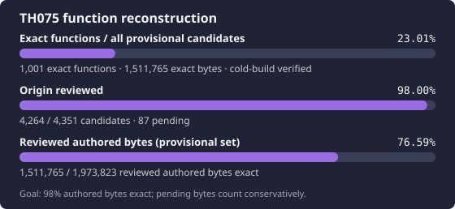

# 東方萃夢想 ～ Immaterial and Missing Power

Agent workflow: follow the highest-priority requirements in [AGENTS.md](AGENTS.md).

A function-by-function C++ reconstruction of the Japanese TH075 v1.11
executable, rebuilt with the original VC7.1 compiler. A function counts only
when its whole callable body, including every
relocation, cold-builds byte-identical to the original.

## Status

`scripts/repo-python scripts/report-reconstruction-status.py --summary`
prints the live exact coverage and origin counts. The conservative
coverage exceeds the 98% authored-byte goal. Every function currently
classified as independently authored has an accepted exact comparison,
including the fighter and object `Advance` methods and the stage base
constructor. The conservative coverage includes all pending-origin bytes.

## Where to start

- [Handoff](docs/RE_HANDOFF.md) with current work and blockers
- [Advance reconstruction](docs/GIANTS.md) with the accepted source index and compiler evidence
- [Pending origin evidence](docs/ORIGIN_PENDING_REVIEW.md#r288--remaining-origin-evidence)
- [Knowledge base](docs/KNOWLEDGE_BASE.md), [workflow](docs/RE_WORKFLOW.md) and [storage policy](docs/STORAGE_HYGIENE.md)

| Subsystem | Entry point |
| --- | --- |
| [Battle](src/battle/) | [Scene phases and HUD state](src/battle/BattleScene.hpp), [shared fighter layout](src/battle/Fighter.hpp) |
| [Characters](src/characters/) | [Stage rendering](src/characters/CharacterStageRendering.cpp), [fighter and object entry points](docs/GIANTS.md) |
| [Replay](src/replay/) | [File header, record header and input streams](src/replay/ReplayRecords.hpp) |
| [Input](src/input/) | [Device mapping and held controls](src/input/InputMapping4388D0.hpp) |
| [Configuration](src/config/) | [Saved key bindings](src/config/GameConfigStorage.hpp) |
| [Engine](src/engine/) | [Scene commands](src/engine/SceneTransition.hpp), [score data](src/engine/GameProgress.hpp) |
| [Menus](src/ui/) | [Character selection](src/ui/CharacterSelectScene.hpp), [results browser](src/ui/ResultListScene.hpp) |
| [Resources](src/assets/) | [Archive index](src/assets/DataArchive.hpp), [story script records](src/assets/ScriptResource4205F0.hpp) |
| [Graphics](src/graphics/) | [Texture management](src/graphics/TextureManagerF198.hpp) |
| [Audio](src/audio/) | [Streaming](src/audio/AudioStream.hpp), [sound effects](src/audio/SoundBank.hpp) |
| [Platform](src/platform/) | [Windows startup and main loop](src/platform/WinMainF1171.cpp) |

`probes/` contains sources included by accepted exact units.

`config/match-units.toml` records the compiler profiles, extents and
relocations. The target is the user-supplied Japanese TH075 v1.11
`resources/th075.exe`. [Pinned executable identity](docs/RE_HANDOFF.md)

## Build

Build the configured translation units as a Windows x86 COFF library:

    scripts/repo-python scripts/build.py --library

This writes `build/program/th075.lib` and the compiler and librarian logs
under `build/program/`. The build uses the manifest's per-source flags,
the pinned VC7.1 toolchain and the game's headless Factory Wine prefix.

Build the Windows x86 executable:

    scripts/repo-python scripts/build.py --program

This writes `build/program/th075.exe`, `build/program/th075.map` and
`build/program/link.log`. Both aggregate builds use the pinned original
executable in `resources/` to supply read-only data. The linked executable
and the original completed the same four external replay recordings with
matching battle checkpoints. [Build and replay evidence](docs/RE_HANDOFF.md)

For a runtime check, stage the executable beside `th075.dat`,
`th075bgm.dat`, and `th075b.dat` from the Japanese installation.
Create a writable `replay/` directory beside them. Story mode opens
`replay/replay.tmp` before loading the first battle.
[Runtime and position independence checks](docs/POSITION_INDEPENDENCE.md)

## Checks

Read-only preflight:

    git status --short --branch
    scripts/repo-python scripts/verify-target.py
    scripts/repo-python scripts/validate-tracking.py --require-target
    scripts/repo-python scripts/report-reconstruction-status.py --summary
    scripts/repo-python scripts/ghidra.py check

Accept or re-verify a function with a cold build and complete comparison.
Use `--batch` with repeated `--unit` flags for a larger set of affected units.

    scripts/repo-python scripts/replay-exact-units.py --unit UNIT_NAME

`scripts/repo-python scripts/ci.py` checks syntax, tracking and build
manifests and whitespace without a compiler. Replay only new or affected
units, keep compiler builds serial, and never substitute `th075c.exe`.
