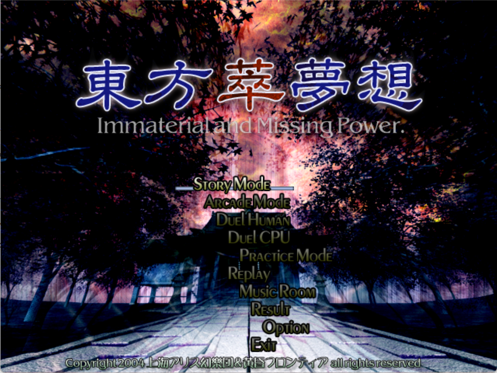
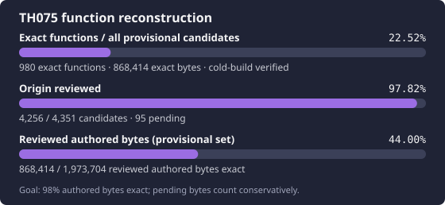

# 東方萃夢想 ～ Immaterial and Missing Power

This is **Japanese TH075 v1.11 original x86 whole-function reconstruction**
in ordinary C++ under the original pinned VC7.1 compiler. It is
**not a complete playable game or an official executable rebuild**.
Only original, attributable, byte-identical **whole callable functions**
earn canonical exact CODE credit. An internal case, original PE-similar
mnemonic stream or matching total source length is not acceptance.

## Current verified status (2026-11-06, F1171 exact ledger / F1240 handoff)

| Property | Grounded result |
| --- | --- |
| Pinned original | User-supplied Japanese resources/th075.exe v1.11 |
| SHA-256 | bd441e99075436e8dcad26f86ffcf5e6aac4f58b0ed3ee7442e4cb39d8e22c98 |
| Original PE image base / file bytes | 0x00400000 / 2,576,384 |
| Provisional native candidates | 4,351 |
| Independently source-attributed original authored functions | 1,004 |
| Complete accepted exact native function units | **982 / 982** |
| Accepted entire callable original CODE | **871,649** B |
| Reviewed authored-byte coverage | **44.16%** of **1,973,704** B |
| Conservative authored coverage | **44.09%** |
| Original authored functions still NONEXACT | **22**: **22** large original state advances (1,102,055 B) plus **0** small/medium original functions (0 B) |
| Original origin-unknown candidate rows | 95 (3,420 uncredited CODE B) |

The 98% authored-byte goal is **NOT met**. Previously confusing
"25 pending plus 11" counts belong to older source-origin
checkpoints: the additional eleven were accepted through F780.
There are currently **22 total** nonexact attributed originals,
not 27 or 36. The original PE, independent provenance decisions,
whole [exact match units](config/match-units.toml) and
live [reconstruction report](scripts/report-reconstruction-status.py)
always outrank historical F-series prose.

## Start here: current task queue

The [**current agent handoff**](docs/RE_HANDOFF.md) provides
the latest verified evidence, all 1,834 direct Boss branch targets and all
5,717 native EBP operands recovered, and the 22 remaining whole-function
targets with targeted reproductions.
The [source workflow](docs/RE_WORKFLOW.md), [AGENTS.md](AGENTS.md),
and [storage and recovery policy](docs/STORAGE_HYGIENE.md) apply
to every session. F1240 compacted 517 obsolete compiler outputs, saving
46.11 MiB net, with every archived member SHA256-verified. Original native
disassembly and selected parents remain loose. **Git-ignored archives and
receipts must travel with a full workspace handoff**. The [knowledge base](docs/KNOWLEDGE_BASE.md)
is a historical experiment journal, **not** a live status report.

The old detailed handoff through F906 was frozen as a
[fully linked historical snapshot](docs/history/RE_HANDOFF_F781_THROUGH_F906_PRE_CLEANUP_2026-10-31.md).
Research performed against an earlier partial fighter or
an old compiler context remains useful evidence but must not
be asserted as the current whole-function result.

### Continue the complete giant research parents

Thirteen of the 22 pending giants now have complete tracked C++ research
bodies; nine still need complete bodies. Every pending giant remains NONEXACT.
The [current handoff](docs/RE_HANDOFF.md) indexes all selected sources,
objects, native proofs and register/width debt, including the latest complete
43KB `0057D580` parent. The three fighters below retain independent
whole-function PE destination audits:

| Native whole Boss | Current complete research-source geometry | Physical original external PE target evidence |
| --- | --- | ---: |
| `004AC040` 82,796B | **82,796B/22,721 x86**, native frame and saved this; still **12 width /6,958 GPR** defects | [F1028](docs/THIRD_FIGHTER_WHOLE_82KB_PE_TARGETS_F1028.md): **2,191/2,191** |
| `00543210` 58,294B | **58,293B/16,471 x86**; still **3 width /1,741 GPR** defects | [F1025](docs/FIGHTER_58KB_ALL_NATIVE_PE_TARGETS_F1025.md): **1,697/1,697** |
| `005214B0` 46,755B | **46,754B/13,230 x86**; still **5 width /2,736 GPR** defects | [F1026](docs/FIGHTER_46KB_ALL_NATIVE_PE_TARGETS_F1026.md): **1,341/1,341** |

These **5,229** physical native PE targets are genuine call/global
addresses, **not** proof that the whole machine bytes, GPR allocation,
jump displacements or COFF field positions match. Specifically,
F1020's [native 82KB frame/counter correction](docs/THIRD_FIGHTER_SHARED_REAL_RING_LOCAL_F1020.md)
recovered one real shared 2DB shot-loop variable, while
[F1029](docs/THIRD_FIGHTER_NATIVE_259_ANGLE_GPR_F1029.md) rules out
eight angle-expression spellings without improving the remaining
register phase. The **81,539B `0050A580`** has now reached an original-shaped
**81,542B/17,435-x86** C++ parent, with original frame/stack slots,
both 391 x87 load fields and every direct branch target recovered, but
**522 GPR-role /5 width differences** in eight provisional states.
All 1,357 whole CODE reference destinations and all 92 actual table targets
are now checked; [complete operand proof](docs/CHARACTEROBJECT_WHOLE_OPERAND_PROOF_F1158.md).
It is still **NONEXACT**; see the
[updated giant handoff](docs/RE_HANDOFF.md).
The **60,999B `0045DD70`** and other giant originals must also be
attacked seriously; the
[original dispatch manifest](config/fighter-boss-dispatch-fingerprints.json)
provides the true extents and jump DATA owners.

F1171 accepts the entire **2,987B `00602A60` WinMain**, plus all 60B of
owned scene-table DATA and 173 real fields; [whole cold-exact proof](docs/WINMAIN_WHOLE_EXACT_F1171.md).
All remaining independently authored whole functions are giants.
F1155 accepted the entire **171B `0041CE50` Archive destructor** through
new[]-paired filename deletion; [cold-exact evidence](docs/ARCHIVE_CATALOG_ARRAY_DELETE_EXACT_F1155.md).
F1157 accepted the entire **248B `0043B0B0` virtual Scene destructor** through
actual scalar deletion of its three HUD objects;
[cold-exact evidence](docs/BATTLE_SCENE_TYPED_DELETE_EXACT_F1157.md).
F1156 also reconciled historical source pins after **268 affected-unit** cold
comparisons, preserving all previous hashes and accepted source improvements;
[scope and evidence](docs/ACCEPTED_SOURCE_PIN_RECONCILIATION_F1156.md).

Already accepted leaf/code semantics are also actively improved:
[F1022 script WORDs](docs/FIGHTER_SCRIPT_COUNTER_ADJACENT_NATIVE_F1022.md)
**46/46 whole cold exact**;
[F1024 animation counters](docs/FIGHTER_ANIMATION_PHASE_WINDOW_F1024.md)
**9/9**; [F1027 action/timer WORDs](docs/FIGHTER_NATIVE_ACTION_TIMER_PAIR_F1027.md)
**46/46**. These bytes were accepted before those type improvements,
so no duplicate authored CODE credit is due.

## Safe reconstruction workflow

Treat the Git worktree as one worker's work. Inspect **all**
dirty tracked, untracked and relevant ignored research.
Always verify the SHA-pinned original th075.exe, **never**
substitute th075c.exe, and compile only the touched unit
serially under the pinned headless Wine VC7.1 toolchain.

Read-only preflight (no native compiler replay):

    git status --short --branch
    scripts/repo-python scripts/verify-target.py
    scripts/repo-python scripts/validate-tracking.py --require-target
    scripts/repo-python scripts/report-reconstruction-status.py --summary
    scripts/repo-python scripts/audit-active-handoff.py
    scripts/repo-python scripts/ghidra.py check

Only newly accepted or modified **complete callable game functions**
need a targeted canonical replay:

    scripts/repo-python scripts/replay-exact-units.py --unit UNIT_NAME

Cold-replay only new or affected units; do **not** replay the entire exact corpus.
For normal source experiments use the current unit's
targeted verifier linked from [the handoff](docs/RE_HANDOFF.md).
No fake stack locals, forced assembly register patches,
unproved original provenance, case-only accepted bytes
or masked physically shifted PE relocation fields.
Commit substantial progress several times per session using
the required prefix **gpt-web: xxx**. Git commits are
checkpoints, not Oracle acceptance; no push is assumed.

## Storage, original evidence and recoverability

Preserve the original EXE, VC7.1/Wine, Ghidra, accepted matching objects,
source/manifests, native evidence, selected research parents and every
archive/receipt. F1240 compacted 473 frozen OBJ/PDB files and 44 generated
listings from F1133–F1230 after complete per-member SHA256 verification.
All 91 original native disassembly views included in the first listing batch
were restored and verified loose; they are excluded from further compaction.
Net archival savings are **48,351,068 B (46.11 MiB)**.

Use the [current recovery script](scripts/archive-handoff-outputs-f1240.py)
and [storage guide](docs/STORAGE_HYGIENE.md) for exact identities and commands.
Older archives retain their own recovery tools, including
[scripts/archive-recent-probe-objects-f907.py](scripts/archive-recent-probe-objects-f907.py)
and [scripts/archive-frozen-giant-traces.py](scripts/archive-frozen-giant-traces.py).
The archive and adjacent receipt are **machine-local, Git-ignored evidence**;
a fresh clone does not include them. Transfer the existing environment or copy
these files independently. Never delete the only local copy of compressed
research or compiler/PE provenance evidence.
